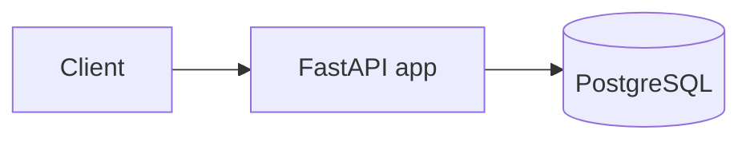
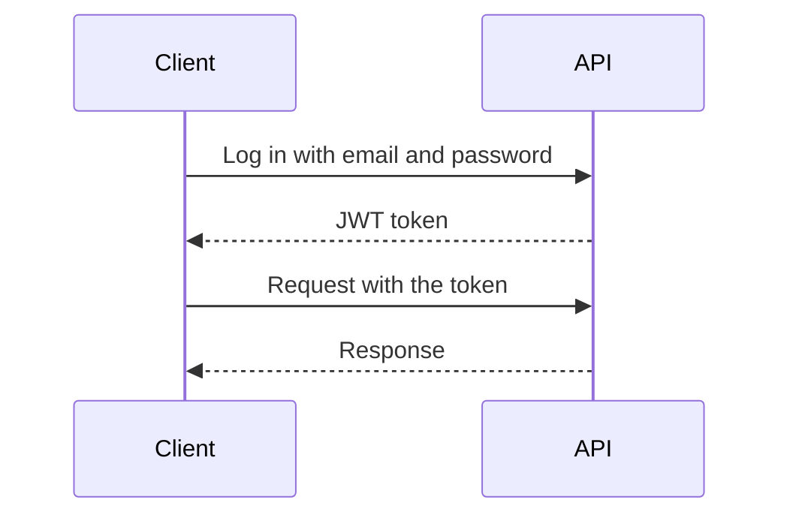

# Workspace Booking API

[](https://github.com/juanvnet/workspace-booking-api/actions/workflows/ci.yml)

A REST API to book meeting rooms in an office.
Users log in and book a room for a time slot, and the API makes sure that
**the same room is never booked twice at the same time**.

Built with **FastAPI**, **PostgreSQL** and **Docker**.

---

## Features

- Register and log in with a **JWT token** (passwords are stored hashed with bcrypt).
- **Users** book rooms and manage their own bookings.
- **Admins** create, update and delete rooms.
- A room cannot be booked twice at the same time.
- Bookings must be in the future and last between 5 minutes and 8 hours.
- Times are always stored and returned in **UTC**. All offices are assumed to be in the
  same timezone (Switzerland), so the client converts the times to Swiss local time.

---

## Tech stack

| Area | Tools |
|---|---|
| API | Python 3.15, FastAPI, Pydantic |
| Database | PostgreSQL, SQLModel |
| Security | OAuth2, JWT, bcrypt |
| Tests and code quality | pytest, Ruff |
| Deployment | Docker, Docker Compose, GitHub Actions |

---

## Quick start

You only need [Docker Desktop](https://www.docker.com/products/docker-desktop/) running.

```bash
git clone https://github.com/juanvnet/workspace-booking-api.git && cd workspace-booking-api
cp .env.example .env
docker compose up --build
```

Then open **http://localhost:8000/docs** to see and try all the endpoints.

> On Windows, use `copy .env.example .env` instead of `cp`.

An admin account is created automatically with the `ADMIN_EMAIL` and `ADMIN_PASSWORD`
from `.env`. In `/docs`, click **Authorize** and log in with them.

> Before using the API outside your computer, change `SECRET_KEY` and the passwords in `.env`.

To stop the API: `docker compose down`.

---

## Run without Docker

You only need Python 3.15. The API uses a local SQLite file instead of PostgreSQL.

```bash
git clone https://github.com/juanvnet/workspace-booking-api.git && cd workspace-booking-api
cp .env.example .env               # Windows: copy .env.example .env
py -3.15 -m venv .venv             # macOS / Linux: python3.15 -m venv .venv
.venv\Scripts\activate             # macOS / Linux: source .venv/bin/activate
pip install -r requirements.txt
uvicorn app.main:app --reload
```

Then open **http://localhost:8000/docs**. The `booking.db` file is created automatically.

---

## How it works



The API and the database run in two Docker containers. The code is in the `app/` folder:

| File | What it does |
|---|---|
| `main.py` | Starts the app and connects the routers |
| `routers/` | The endpoints: `users.py`, `rooms.py`, `bookings.py` |
| `models.py` | The database tables and the data the API receives and returns |
| `auth.py` | Passwords, JWT tokens and permissions |
| `config.py` | Settings read from the `.env` file |
| `database.py` | Connection to the database |

The database tables are created automatically when the API starts.

---

## Authentication



1. The user logs in at `POST /api/v1/users/token` and receives a **token**.
2. The user sends the token in every request: `Authorization: Bearer <token>`.
3. Without a valid token the API answers `401`. A normal user calling an admin
   endpoint gets `403`.

---

## Endpoints

| Method | Path | Who | Description |
|---|---|---|---|
| `POST` | `/api/v1/users/register` | Everyone | Create an account |
| `POST` | `/api/v1/users/token` | Everyone | Log in |
| `GET` | `/api/v1/users/me` | User | See your profile |
| `PATCH` | `/api/v1/users/me` | User | Change your email, name or password |
| `GET` | `/api/v1/rooms` | User | List the rooms |
| `GET` | `/api/v1/rooms/{id}` | User | See one room |
| `POST` | `/api/v1/rooms` | Admin | Create a room |
| `PATCH` | `/api/v1/rooms/{id}` | Admin | Update a room |
| `DELETE` | `/api/v1/rooms/{id}` | Admin | Delete a room without bookings |
| `POST` | `/api/v1/bookings` | User | Book a room |
| `GET` | `/api/v1/bookings` | User | List your bookings (admins see all) |
| `GET` | `/api/v1/bookings/{id}` | User | See one of your bookings |
| `POST` | `/api/v1/bookings/{id}/cancel` | User | Cancel one of your bookings |
| `GET` | `/health` | Everyone | Check that the API is running |

---

## Example with curl

`curl` lets you call the API from a terminal, without the browser.
These three steps create a user, log in and book a room.
You can do exactly the same from `/docs`.

**1. Create a user**

```bash
curl -X POST http://localhost:8000/api/v1/users/register \
  -H "Content-Type: application/json" \
  -d '{"email": "pepe@example.com", "full_name": "Pepe Prado", "password": "pepe-password"}'
```

**2. Log in.** The OAuth2 standard calls the login field `username`, but you send your **email** in it.
The answer contains your token (`access_token`). Copy it for the next step.

```bash
curl -X POST http://localhost:8000/api/v1/users/token \
  -d "username=pepe@example.com&password=pepe-password"
```

**3. Book a room.** Replace `YOUR_TOKEN` with your token. The room must exist (an admin creates it).

```bash
curl -X POST http://localhost:8000/api/v1/bookings \
  -H "Authorization: Bearer YOUR_TOKEN" \
  -H "Content-Type: application/json" \
  -d '{"room_id": 1, "title": "Sprint review", "start_at": "2030-03-10T09:00:00+01:00", "end_at": "2030-03-10T10:00:00+01:00"}'
```

The answer shows the times in UTC (`08:00:00Z`), because `+01:00` is the Swiss winter time.
If the room is already booked at that time, the API answers `409`.

---

## Run the tests

The tests use a temporary database in memory, so they do not need Docker.

```bash
py -3.15 -m venv .venv             # macOS / Linux: python3.15 -m venv .venv
.venv\Scripts\activate             # macOS / Linux: source .venv/bin/activate
pip install -r requirements-dev.txt
pytest
```

There are **52 tests** for users, rooms and bookings.
They also run automatically on GitHub after every push (GitHub Actions).

---

## Skills shown

- Building a REST API with **FastAPI**: validation, dependencies and status codes.
- **Authentication and permissions** with OAuth2, JWT and two user roles.
- **Business rules**: overlapping bookings, time limits and timezones.
- Working with a database through **SQLModel** and **PostgreSQL**.
- **Automated tests** with pytest.
- **Docker** and continuous integration with **GitHub Actions**.

---

## License

[MIT](LICENSE)